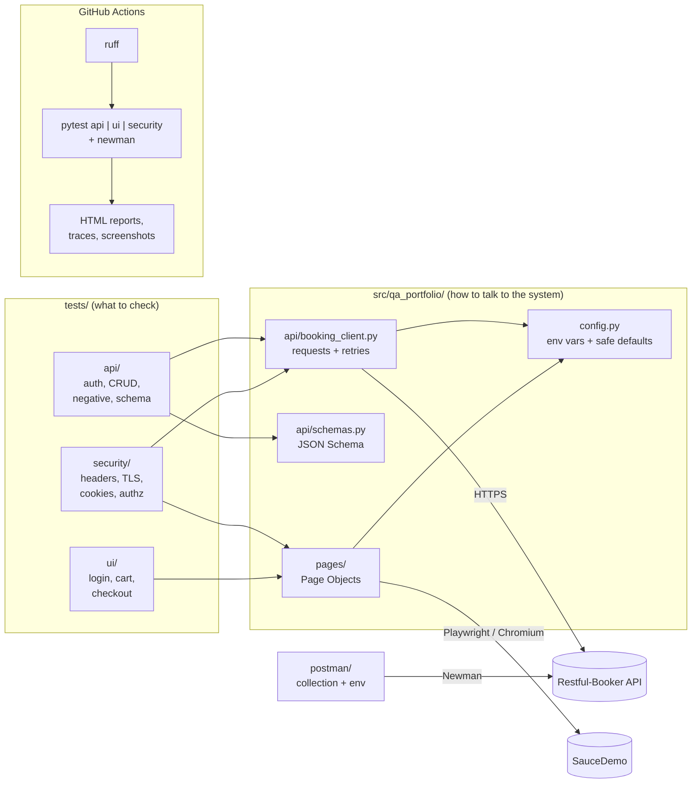

# QA Automation Portfolio

[](https://github.com/romanszlazakai-lgtm/qa-automation-portfolio/actions/workflows/ci.yml)

API, UI and passive security test automation in Python, written the way I would set it up for a team: layered framework, strict API contracts, Page Objects, honest handling of known defects and flaky third-party dependencies, and a CI pipeline that publishes reports.

All tests run against **public practice targets** that exist to be tested:

- [Restful-Booker](https://restful-booker.herokuapp.com) - REST API (hotel bookings)
- [SauceDemo](https://www.saucedemo.com) - web shop (login, cart, checkout)

No employer data, no real credentials. The default usernames and passwords are the demo values published on those sites.

## What it shows

| Area | Highlights |
|---|---|
| **API tests** (`tests/api`) | Auth, full CRUD, negative cases, JSON Schema contract checks, data-driven cases with `parametrize`, fixtures that create test data and always clean it up |
| **UI tests** (`tests/ui`) | Playwright + Page Object Model, login (valid, locked, invalid), cart, sorting, checkout with money arithmetic checked in `Decimal`, screenshot and trace on failure |
| **Security checks** (`tests/security`) | Passive only: security headers, TLS and certificate, HTTP to HTTPS redirect, cookie flags, pages and API writes without valid auth, error message leakage. OWASP ZAP baseline as a separate manual workflow |
| **Postman** (`postman/`) | Same API flow as a Postman collection, run with Newman in CI |
| **CI** (`.github/workflows`) | ruff lint, then API, UI, security and Newman jobs in parallel, HTML reports uploaded as artifacts |
| **Docs** | [Test plan](docs/test-plan.md) in a standard test-plan format |

## Architecture



Tests describe *what* to check. Everything about *how* to reach the system (URLs, HTTP details, selectors) lives in `src/`. When SauceDemo changes a button, one Page Object changes, not twenty tests.

## Run it locally

Requires Python 3.11+. In a fresh virtual environment (`python -m venv .venv` and activate it):

```bash
pip install -e .
```

```bash
playwright install chromium
```

```bash
pytest
```

Useful variations:

```bash
pytest tests/api                      # one suite
pytest -m smoke                       # fast subset
pytest tests/ui --headed --slowmo 300 # watch the browser
pytest --html=reports/report.html --self-contained-html
```

Postman collection (requires Node 18+):

```bash
npm ci && npm run test:postman
```

### Configuration

Every setting has a safe default, so nothing is required. Override with environment variables:

| Variable | Default |
|---|---|
| `API_BASE_URL` | `https://restful-booker.herokuapp.com` |
| `API_USERNAME` / `API_PASSWORD` | `admin` / `password123` (public demo values) |
| `UI_BASE_URL` | `https://www.saucedemo.com` |
| `UI_PASSWORD` | `secret_sauce` (public demo value) |
| `REQUEST_TIMEOUT` | `15` seconds |

Restful-Booker can also be run locally in Docker and targeted with `API_BASE_URL=http://localhost:3001`.

## Test strategy

**Each test owns its data.** Restful-Booker is shared by everyone on the internet. Every API test creates a booking with a unique name and a fixture deletes it in teardown, even if the test fails.

**Negative tests check state, not just status codes.** After a rejected update or delete, the test reads the booking back and asserts it did not change. A 403 that still modifies data would be the worst kind of bug.

**Strict contracts.** JSON Schemas use `additionalProperties: false`, so a new or renamed field fails the test instead of slipping through.

**Known defects are visible, not hidden.** Where the target behaves wrongly (for example a failed login returns `200` instead of `401`), the test asserts the *correct* behaviour and is marked `xfail` with a `KNOWN DEFECT` or `SECURITY FINDING` reason. `xfail_strict = true` means that if the defect is fixed, the test turns red and the mark has to be removed, so the list never goes stale.

**Flaky external dependencies are handled openly.**
- The API client retries `502/503/504` only for idempotent methods, so a retry can never create a duplicate booking.
- In CI, pytest reruns a test only for network errors (`ConnectionError`, `ReadTimeout`, `net::ERR`). Assertion failures are never retried. Every rerun is listed in the HTML report.

**Failures are easy to debug.** Failed UI tests keep a screenshot (also embedded in the HTML report) and a Playwright trace (`playwright show-trace <file>`), uploaded as CI artifacts.

### Known defects and findings on the targets

These are recorded by tests marked `xfail`. They are findings on deliberately simple demo systems, listed here the way I would list them in a test report.

| Target | Finding | Type |
|---|---|---|
| Restful-Booker | Failed login returns `200` with `{"reason": "Bad credentials"}` instead of `401` | Defect |
| Restful-Booker | Missing required field returns `500` instead of `400` | Defect |
| Restful-Booker | Accepts checkout date before checkin date | Defect (business rule) |
| Restful-Booker | Accepts negative total price | Defect (business rule) |
| Restful-Booker | No HSTS, X-Content-Type-Options, CSP, frame protection or Referrer-Policy | Security finding |
| Restful-Booker | `X-Powered-By: Express` reveals the framework | Security finding (information disclosure) |
| Restful-Booker | Plain HTTP answers `200` instead of redirecting to HTTPS | Security finding |
| SauceDemo | No HSTS, X-Content-Type-Options, CSP, frame protection or Referrer-Policy (hosted on GitHub Pages, which does not allow custom headers) | Security finding |
| SauceDemo | Session cookie set from JavaScript: no `Secure`, no `HttpOnly` | Security finding |

What passes is just as useful: both targets use TLS 1.2+ with valid certificates, SauceDemo redirects HTTP to HTTPS, every protected SauceDemo page requires login, the login error does not reveal whether the username exists, and every Restful-Booker write without a valid token is refused with the data left unchanged.

The source of truth is the `KNOWN_FINDINGS`, `NO_HTTPS_REDIRECT` and `COOKIE_FINDINGS` tables in `tests/security`.

### Deliberately out of scope

- **Load and performance tests**: they would put load on free services that did not ask for it.
- **Active security testing** (injection, fuzzing, brute force, active ZAP scan): not legal or fair against systems I do not own. The ZAP workflow uses the *baseline* (passive) scan only, and only when started by hand.
- **Cross-browser, mobile, visual and accessibility testing**: Chromium only to keep CI fast; other browsers are one flag away (`--browser firefox`).

More detail in the [test plan](docs/test-plan.md).

## How this maps to banking QA

| Part of this repo | Banking concern it practises |
|---|---|
| Authorization tests that re-read data after a rejected write | Account and payment data must not change without proper authorization (PSD2, strong customer authentication) |
| Same error for unknown user and wrong password | No user enumeration on login pages |
| Checkout totals checked with `Decimal` | Money is never `float`; subtotal + tax = total must hold to the cent |
| Business-rule tests (dates, negative price) | Validation of transfers, limits and dates, where a `200` on bad input is a defect |
| Strict JSON Schemas | API contracts between core banking, channels and partners (Open Banking APIs) |
| Security headers, TLS, cookie flags, access control | Baseline controls from OWASP ASVS that internal security teams and auditors ask about |
| Known defects tracked as strict xfail | Traceable known-issue lists in release notes and test reports |
| Postman collection run by Newman | Turning manual Postman checks into regression tests in a pipeline |
| Each test creates and cleans its own data | Shared test environments where many teams use the same data |

## Project layout

```
.
├── src/qa_portfolio/
│   ├── config.py              # settings from env vars
│   ├── api/                   # BookingClient, payload builders, JSON Schemas
│   └── pages/                 # Page Objects for SauceDemo
├── tests/
│   ├── conftest.py            # shared fixtures, suite markers
│   ├── api/                   # Restful-Booker tests
│   ├── ui/                    # SauceDemo tests
│   └── security/              # passive security checks
├── postman/                   # collection + environment for Newman
├── docs/test-plan.md
├── .github/workflows/
│   ├── ci.yml                 # lint, pytest suites, newman
│   └── zap-baseline.yml       # manual OWASP ZAP baseline scan
└── pyproject.toml             # pinned dependencies, pytest and ruff config
```

## Tech stack

Python 3.12, pytest, requests, jsonschema, Playwright for Python, pytest-html, pytest-rerunfailures, ruff, Postman / Newman, GitHub Actions, OWASP ZAP.
